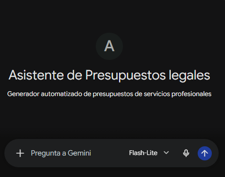
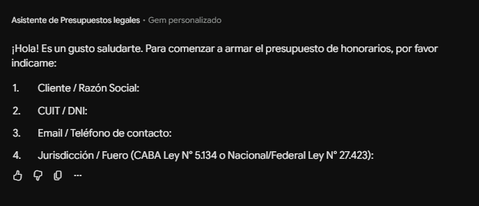
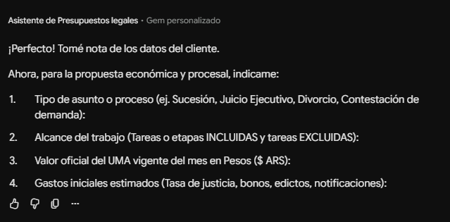
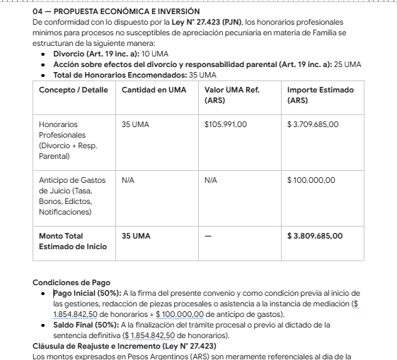

# Presupuestador Jurídico Inteligente

Asistente virtual y agente automatizado para la confección de presupuestos de honorarios profesionales de abogados en la República Argentina (Ámbito CABA - Ley N° 5.134 y Fuero Nacional - Ley N° 27.423).

---

## 🔗 Prueba la Gema / Agente

> ⚠️ **Aviso Importante sobre la Plataforma:**
> Actualmente la solución se encuentra desplegada como una **Gema de Gemini**. Tené en cuenta que a partir del **17/11**, las Gemas se integrarán y pasarán a ser **Skills de Gemini**, por lo cual la interfaz y el acceso se actualizarán automáticamente a la nueva arquitectura de Google.

👉 **[Haz clic aquí para probar el Presupuestador Jurídico Inteligente](https://gemini.google.com/gem/12y2BMSEypNWNmpN116KkvAx7sk0vO1Fp?usp=sharing)** 

---

## 📌 Descripción del Proyecto

El **Presupuestador Jurídico Inteligente** es un agente automatizado diseñado para optimizar el flujo de trabajo de profesionales independientes y estudios jurídicos. Permite automatizar la revisión arancelaria, el cálculo de UMAs (Unidad de Medida Arancelaria) y la redacción de propuestas comerciales/jurídicas ejecutivas, reduciendo tiempos administrativos y eliminando errores humanos.

---

## 🚀 Problema que Soluciona

- **Pérdida de tiempo operativo:** La elaboración manual de presupuestos exige consultar tablas arancelarias, realizar conversiones monetarias y redactar documentos desde cero.
- **Riesgo de desactualización normativa:** La utilización de leyes derogadas, escalas incorrectas o valores de UMA desfasados.
- **Inconsistencia de formato:** Errores tipográficos o falta de estandarización en las propuestas enviadas a clientes.
- **Complejidad en pretensiones múltiples:** Dificultad para liquidar y consolidar varios rubros en un mismo escrito (ej. Divorcio + Responsabilidad Parental).

---

## ✨ Características Principales

- **Entrada Flexible de Datos:** Soporta tanto el análisis de un borrador/briefing del caso como un formulario guiado paso a paso.
- **RAG con Control Normativo:** Base de conocimientos empaquetada con la **Ley N° 27.423** (Nación/Federal) y la **Ley N° 5.134** (CABA).
- **Validación Humana del UMA:** Solicita el valor oficial vigente en pesos ($ ARS) para garantizar exactitud y aplicar la cláusula legal de reajuste.
- **Protección de Datos:** Permite procesar casos con datos anónimos o ficticios y completar la información real tras la exportación.
- **Exportación a Google Workspace:** Genera el informe final con un clic para editar o guardar directamente en Google Docs / Google Drive.

---

## 📸 Flujo de Trabajo y Capturas

### 1. Interfaz del Asistente


---

### 2. Fase 1: Solicitud e Ingreso de Datos
El asistente inicia la interacción solicitando los datos del cliente y los parámetros procesales.


---

### 3. Fase 2: Alcance y Propuesta Económica
Se definen las tareas incluidas, el valor de referencia del UMA y los gastos iniciales estimados.


---

### 4. Fase 3: Emisión del Informe y Exportación
El informe se genera con formato profesional estandarizado y habilita la exportación a Google Drive.


---

### 5. Prueba de Fuego: RAG y Cálculo Múltiple
Demostración de la capacidad del asistente para cruzar dos pretensiones de la ley (Divorcio 10 UMA + Responsabilidad Parental 25 UMA = 35 UMA) y estructurar las condiciones de pago.


---

## 📁 Estructura del Repositorio

```text
├── README.md
├── system_prompt.txt
├── assets/
│   ├── asistente.png
│   ├── etapa_1.png
│   ├── etapa_2.png
│   ├── etapa_3.png
│   └── resultado_parcial.png
└── knowledge/
    ├── ley_27423_nacion.pdf
    ├── ley_5134_caba.pdf
    └── plantilla_modelo_presupuesto.docx
 ```
 
## 👩‍💻 Autora

**Noelia Natalia María Orsini**  
Abogada (UBA) | Consultora Psicológica | Desarrolladora Backend, IA & Automatizaciones

* 💼 **LinkedIn:** [linkedin.com/in/noelia-orsini](https://www.linkedin.com/in/noelia-orsini)
* 🐙 **GitHub:** [github.com/NoeliaOrsini](https://github.com/NoeliaOrsini)
* 🌐 **Portafolio:** [noelia-orsini-portafolio.lovable.app](https://noelia-orsini-portafolio.lovable.app/)